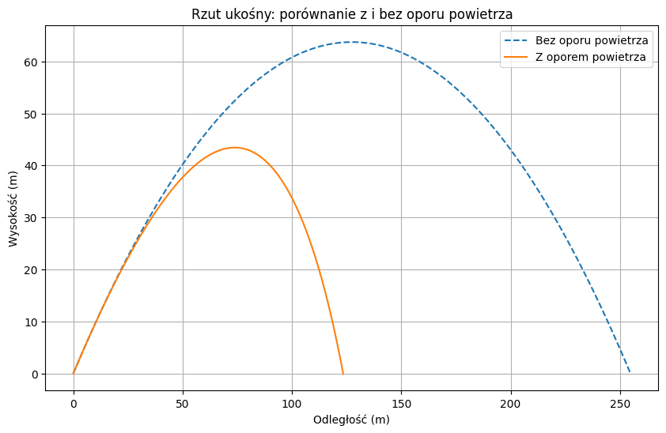

# Tytuł projektu

## Pierwsza podsekcja

To jest krótki tekst umieszczony w pierwszej podsekcji. Zawiera on **pogrubiony fragment**, *pochylony fragment* oraz ~~przekreślony fragment~~

Przydatne wzory matematyczne w tekście:
- Wzór na energię: $E = mc^2$
- Twierdzenie Pitagorasa: $a^2 + b^2 = c^2$
- Funkcja kwadratowa: $f(x) = x^2$
## Druga podsekcja

To jest kolejny krótki tekst w ramach drugiej podsekcji. Znajdziesz tutaj link do platformy [Google Colab](http://colab.research.google.com)

### Lista punktowana
* Pierwszy element listy
* Drugi element listy
* Trzeci element listy

### Lista numerowana
1. Pierwszy krok
2. Drugi krok
3. Trzeci krok

### Checklista
- [x] Zadanie wykonane
- [ ] Zadanie do zrobienia

### Tabela
| Cecha | Wartość | Status |
| :--- | :--- | :--- |
| Test 1 | Ok | Zaliczone |
| Test 2 | Błąd | Do poprawy |

### Kod w języku Python
```python
def powitanie(imie):
    print(f"Witaj, {imie}!")

powitanie("Świat")
```[cite: 1]

### Wzory matematyczne w osobnym bloku

$$ \int_0^\infty e^{-x^2} dx = \frac{\sqrt{\pi}}{2} $$

$$ e^{i\pi} + 1 = 0 $$

$$ F = G \frac{m_1 m_2}{r^2} $$

### Osadzony wykres

