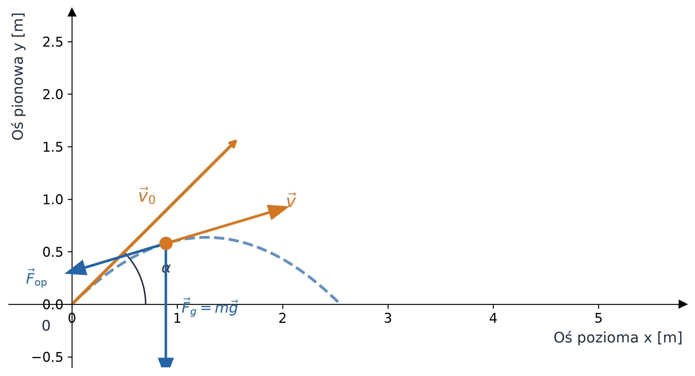

# Rzut ukośny — od paraboli Galileusza do krzywej balistycznej

*Raport obliczeniowy i przykład wykorzystania Markdown w dokumentacji naukowej.*

**Temat:** dwuwymiarowy ruch punktu materialnego w jednorodnym polu grawitacyjnym bez oporu powietrza oraz z jego uwzględnieniem.  
**Metoda:** rozwiązania analityczne, całkowanie numeryczne w Pythonie i interpretacja wykresów.  
**Charakter danych:** przykład modelowy; wszystkie wykresy przedstawiają wyniki obliczeń dla zadanych parametrów początkowych, a nie pomiary laboratoryjne.

Galileusz zauważył, że
> złożony ruch ciała wyrzuconego ukośnie można rozłożyć na dwa niezależne ruchy: jednostajny w poziomie i jednostajnie zmienny w pionie.

Newton stwierdził, że
> przyspieszenie ciała jest proporcjonalne do wypadkowej siły działającej na to ciało i odwrotnie proporcjonalne do jego masy.

Połączenie tych zasad daje układ równań różniczkowych opisujących tor lotu. W próżni rozwiązaniem jest symetryczna parabola. Po uwzględnieniu oporu powietrza ruch poziomy i pionowy przestają być niezależne, a tor staje się niesymetryczną krzywą balistyczną. W tym raporcie analizujemy położenie, prędkość, zasięg oraz energię ciała w obu modelach.

Współrzędne położenia mówią, gdzie ciało znajduje się w przestrzeni. Składowe prędkości mówią, dokąd i jak szybko zmierza. Dopiero razem w pełni opisują stan układu w danej chwili.

## Spis treści

1. [Cel i model fizyczny](#1-cel-i-model-fizyczny)
2. [Równania ruchu bez oporu powietrza](#2-równania-ruchu-bez-oporu-powietrza)
3. [Przykład liczbowy i analiza toru w modelu idealnym](#3-przykład-liczbowy-i-analiza-toru-w-modelu-idealnym)
4. [Energia mechaniczna w trakcie lotu](#4-energia-mechaniczna-w-trakcie-lotu)
5. [Rzut ukośny z oporem powietrza](#5-rzut-ukośny-z-oporem-powietrza)
6. [Porównanie modeli i optymalny kąt rzutu](#6-porównanie-modeli-i-optymalny-kąt-rzutu)
7. [Kod i odtwarzanie wykresów](#7-kod-i-odtwarzanie-wykresów)
8. [Ograniczenia modelu i propozycja doświadczenia](#8-ograniczenia-modelu-i-propozycja-doświadczenia)
9. [Wnioski](#9-wnioski)
10. [Dalsza lektura](#10-dalsza-lektura)

---

## 1. Cel i model fizyczny

Dlaczego kamień wyrzucony pod pewnym kątem do poziomu wznosi się, osiąga najwyższy punkt, a następnie opada po zakrzywionym torze? Nadana prędkość początkowa unosi ciało w górę i do przodu, podczas gdy stała siła grawitacji nieustannie zmniejsza pionową składową prędkości. W rzeczywistych warunkach dochodzi do tego opór ośrodka, który hamuje ciało na całej długości toru i skraca jego zasięg.

Celem raportu jest wyprowadzenie równań ruchu dla **rzutu ukośnego**, wyznaczenie toru lotu, prędkości, zasięgu, wysokości maksymalnej oraz energii mechanicznej w modelu idealnym, a następnie zbadanie numeryczne wpływu oporu powietrza (liniowego i kwadratowego) na kształt trajektorii oraz optymalny kąt wyrzutu.

### 1.1. Założenia

- Ruch odbywa się w jednej pionowej płaszczyźnie $(x, y)$, bez wiatru bocznego.
- Ciało traktujemy jako punkt materialny o stałej masie $m$ (pomijamy jego ruch obrotowy i efekt Magnusa).
- Pole grawitacyjne jest jednorodne, a przyspieszenie ziemskie ma stałą wartość $g = 9{,}81\,\mathrm{m/s^2}$ i zwrot pionowo w dół (pomijamy krzywiznę oraz ruch obrotowy Ziemi).
- W modelu idealnym pomijamy opór powietrza oraz siłę wyporu.
- W modelu z oporem powietrza uwzględniamy siłę oporu skierowaną zawsze przeciwnie do wektora prędkości chwilowej $\vec{v}$: proporcjonalną do prędkości ($\vec{F}_{\mathrm{op}} = -b\vec{v}$) lub do jej kwadratu ($\vec{F}_{\mathrm{op}} = -c\,v\vec{v}$).

Początek układu współrzędnych $(0, 0)$ umieszczamy w punkcie wyrzutu. Oś $x$ skierowana jest poziomo zgodnie z kierunkiem rzutu, a oś $y$ — pionowo w górę. Lot kończy się w chwili ponownego osiągnięcia poziomu $y = 0$.

Obliczenia w dalszej części raportu wykonano dla parametrów początkowych wynikających z numeru indeksu: prędkości początkowej $v_0 = \mathrm{[XX]}\,\mathrm{m/s}$ oraz kąta wyrzutu odpowiadającego $\mathrm{[YY]}^\circ$, czyli $\alpha \approx \mathrm{[ZZ]}\,\mathrm{rad}$ w jednostkach SI.

*Rysunek 1. Schemat układu fizycznego w rzucie ukośnym. Ciało wyrzucone z punktu $(0,0)$ z prędkością $\vec{v}_0$ pod kątem $\alpha$ porusza się pod wpływem stałej siły grawitacji $\vec{F}_g$ oraz — w modelu rzeczywistym — siły oporu $\vec{F}_{\mathrm{op}}$ przeciwnej do chwilowego wektora prędkości $\vec{v}$. Schemat nie zachowuje skali.*

### 1.2. Symbole i jednostki

| Symbol | Znaczenie | Jednostka SI |
| :--- | :--- | :---: |
| $m$ | masa ciała | $\mathrm{kg}$ |
| $g$ | przyspieszenie ziemskie | $\mathrm{m/s^2}$ |
| $x$, $y$ | współrzędne położenia (pozioma i pionowa) | $\mathrm{m}$ |
| $v$, $v_x$, $v_y$ | wartość prędkości oraz jej składowe | $\mathrm{m/s}$ |
| $v_0$ | prędkość początkowa | $\mathrm{m/s}$ |
| $\alpha$ | kąt wyrzutu względem osi $x$ | $\mathrm{rad}$ |
| $a_x$, $a_y$ | składowe przyspieszenia | $\mathrm{m/s^2}$ |
| $t$, $t_c$ | czas i całkowity czas lotu | $\mathrm{s}$ |
| $Z$, $H_{\max}$ | zasięg rzutu i maksymalna wysokość | $\mathrm{m}$ |
| $E_k$, $E_p$, $E$ | energia kinetyczna, potencjalna i całkowita | $\mathrm{J}$ |
| $b$ | współczynnik oporu liniowego | $\mathrm{kg/s}$ |
| $c$ | współczynnik oporu kwadratowego ($\frac{1}{2}\rho C_d S$) | $\mathrm{kg/m}$ |
| $\rho$, $C_d$, $S$ | gęstość powietrza, współczynnik oporu, pole przekroju | $\mathrm{kg/m^3}$, bez jednostki, $\mathrm{m^2}$ |

Wszystkie wielkości wyrażamy w układzie SI. Ponieważ jednostką SI kąta płaskiego jest radian, wartość kąta z numeru indeksu podaną w stopniach należy przeliczyć według zależności $\alpha\,[\mathrm{rad}] = \alpha\,[^\circ] \cdot \frac{\pi}{180^\circ}$ (w funkcjach `np.sin` i `np.cos` w Pythonie kąty również podaje się w radianach).