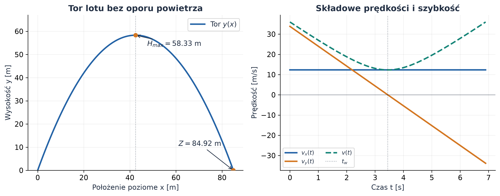
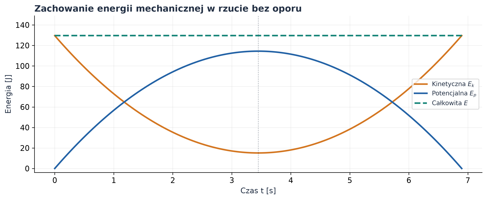
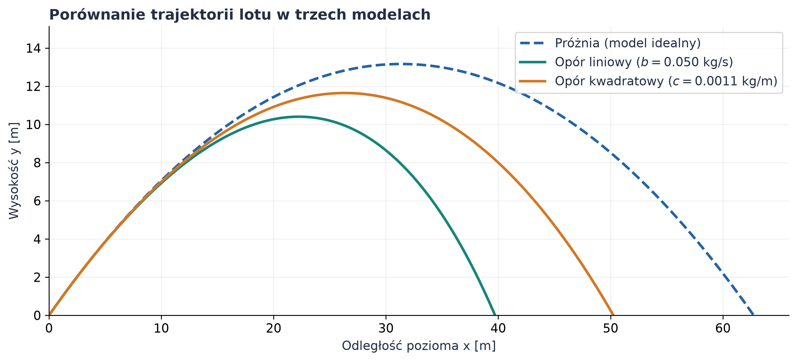
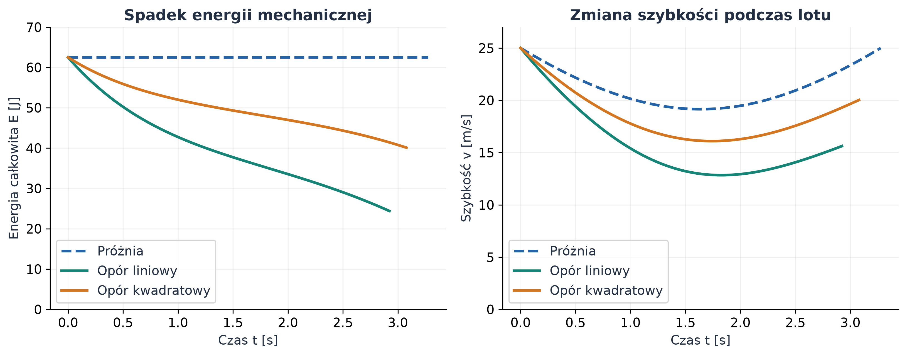
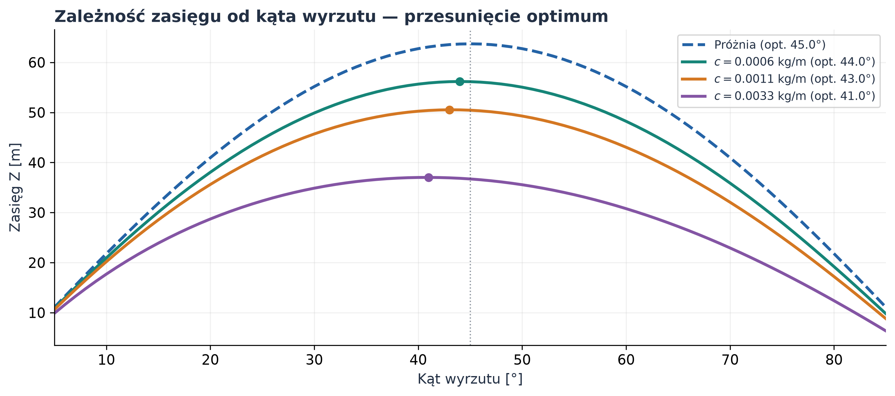
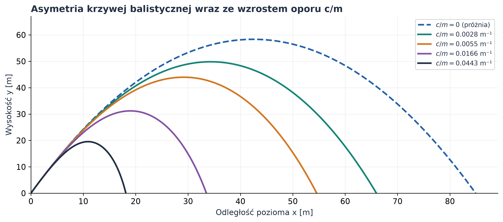

# Rzut ukośny — od paraboli Galileusza do krzywej balistycznej

*Raport obliczeniowy i przykład wykorzystania Markdown w dokumentacji naukowej.*

**Temat:** dwuwymiarowy ruch punktu materialnego w jednorodnym polu grawitacyjnym bez oporu powietrza oraz z jego uwzględnieniem.  
**Metoda:** rozwiązania analityczne, całkowanie numeryczne w Pythonie i interpretacja wykresów.  
**Charakter danych:** przykład modelowy; wszystkie wykresy przedstawiają wyniki obliczeń dla zadanych parametrów początkowych, a nie pomiary laboratoryjne.

Galileusz zauważył, że
> złożony ruch ciała wyrzuconego ukośnie można rozłożyć na dwa niezależne ruchy: jednostajny w poziomie i jednostajnie zmienny w pionie.

Newton stwierdził, że
> przyspieszenie ciała jest proporcjonalne do wypadkowej siły działającej na to ciało i odwrotnie proporcjonalne do jego masy.

Połączenie tych zasad daje układ równań różniczkowych opisujących tor lotu. W próżni rozwiązaniem jest symetryczna parabola. Po uwzględnieniu oporu powietrza ruch poziomy i pionowy przestają być niezależne, a tor staje się niesymetryczną krzywą balistyczną. W tym raporcie analizujemy położenie, prędkość, zasięg oraz energię ciała w obu modelach.

Współrzędne położenia mówią, gdzie ciało znajduje się w przestrzeni. Składowe prędkości mówią, dokąd i jak szybko zmierza. Dopiero razem w pełni opisują stan układu w danej chwili.

## Spis treści

1. [Cel i model fizyczny](#1-cel-i-model-fizyczny)
2. [Równania ruchu bez oporu powietrza](#2-równania-ruchu-bez-oporu-powietrza)
3. [Przykład liczbowy i analiza toru w modelu idealnym](#3-przykład-liczbowy-i-analiza-toru-w-modelu-idealnym)
4. [Energia mechaniczna w trakcie lotu](#4-energia-mechaniczna-w-trakcie-lotu)
5. [Rzut ukośny z oporem powietrza](#5-rzut-ukośny-z-oporem-powietrza)
6. [Porównanie modeli i optymalny kąt rzutu](#6-porównanie-modeli-i-optymalny-kąt-rzutu)
7. [Kod i odtwarzanie wykresów](#7-kod-i-odtwarzanie-wykresów)
8. [Ograniczenia modelu i propozycja doświadczenia](#8-ograniczenia-modelu-i-propozycja-doświadczenia)
9. [Wnioski](#9-wnioski)
10. [Dalsza lektura](#10-dalsza-lektura)

---

## 1. Cel i model fizyczny

Dlaczego kamień wyrzucony pod pewnym kątem do poziomu wznosi się, osiąga najwyższy punkt, a następnie opada po zakrzywionym torze? Nadana prędkość początkowa unosi ciało w górę i do przodu, podczas gdy stała siła grawitacji nieustannie zmniejsza pionową składową prędkości. W rzeczywistych warunkach dochodzi do tego opór ośrodka, który hamuje ciało na całej długości toru i skraca jego zasięg.

Celem raportu jest wyprowadzenie równań ruchu dla **rzutu ukośnego**, wyznaczenie toru lotu, prędkości, zasięgu, wysokości maksymalnej oraz energii mechanicznej w modelu idealnym, a następnie zbadanie numeryczne wpływu oporu powietrza (liniowego i kwadratowego) na kształt trajektorii oraz optymalny kąt wyrzutu.

### 1.1. Założenia

- Ruch odbywa się w jednej pionowej płaszczyźnie $(x, y)$, bez wiatru bocznego.
- Ciało traktujemy jako punkt materialny o stałej masie $m$ (pomijamy jego ruch obrotowy i efekt Magnusa).
- Pole grawitacyjne jest jednorodne, a przyspieszenie ziemskie ma stałą wartość $g = 9{,}81\,\mathrm{m/s^2}$ i zwrot pionowo w dół (pomijamy krzywiznę oraz ruch obrotowy Ziemi).
- W modelu idealnym pomijamy opór powietrza oraz siłę wyporu.
- W modelu z oporem powietrza uwzględniamy siłę oporu skierowaną zawsze przeciwnie do wektora prędkości chwilowej $\vec{v}$: proporcjonalną do prędkości ($\vec{F}_{\mathrm{op}} = -b\vec{v}$) lub do jej kwadratu ($\vec{F}_{\mathrm{op}} = -c\,v\vec{v}$).

Początek układu współrzędnych $(0, 0)$ umieszczamy w punkcie wyrzutu. Oś $x$ skierowana jest poziomo zgodnie z kierunkiem rzutu, a oś $y$ — pionowo w górę. Lot kończy się wwww chwili ponownego osiągnięcia poziomu $y = 0$.

Obliczenia w dalszej części raportu wykonano dla parametrów początkowych wynikających z numeru indeksu: prędkości początkowej $v_0 = \mathrm{[XX]}\,\mathrm{m/s}$ oraz kąta wyrzutu odpowiadającego $\mathrm{[YY]}^\circ$, czyli $\alpha \approx \mathrm{[ZZ]}\,\mathrm{rad}$ w jednostkach SI.


*Rysunek 1. Schemat układu fizycznego w rzucie ukośnym. Ciało wyrzucone z punktu $(0,0)$ z prędkością $\vec{v}_0$ pod kątem $\alpha$ porusza się pod wpływem stałej siły grawitacji $\vec{F}_g$ oraz — w modelu rzeczywistym — siły oporu $\vec{F}_{\mathrm{op}}$ przeciwnej do chwilowego wektora prędkości $\vec{v}$. Schemat nie zachowuje skali.*

### 1.2. Symbole i jednostki

| Symbol | Znaczenie | Jednostka SI |
| :--- | :--- | :---: |
| $m$ | masa ciała | $\mathrm{kg}$ |
| $g$ | przyspieszenie ziemskie | $\mathrm{m/s^2}$ |
| $x$, $y$ | współrzędne położenia (pozioma i pionowa) | $\mathrm{m}$ |
| $v$, $v_x$, $v_y$ | wartość prędkości oraz jej składowe | $\mathrm{m/s}$ |
| $v_0$ | prędkość początkowa | $\mathrm{m/s}$ |
| $\alpha$ | kąt wyrzutu względem osi $x$ | $\mathrm{rad}$ |
| $a_x$, $a_y$ | składowe przyspieszenia | $\mathrm{m/s^2}$ |
| $t$, $t_c$ | czas i całkowity czas lotu | $\mathrm{s}$ |
| $Z$, $H_{\max}$ | zasięg rzutu i maksymalna wysokość | $\mathrm{m}$ |
| $E_k$, $E_p$, $E$ | energia kinetyczna, potencjalna i całkowita | $\mathrm{J}$ |
| $b$ | współczynnik oporu liniowego | $\mathrm{kg/s}$ |
| $c$ | współczynnik oporu kwadratowego ($\frac{1}{2}\rho C_d S$) | $\mathrm{kg/m}$ |
| $\rho$, $C_d$, $S$ | gęstość powietrza, współczynnik oporu, pole przekroju | $\mathrm{kg/m^3}$, bez jednostki, $\mathrm{m^2}$ |

Wszystkie wielkości wyrażamy w układzie SI. Ponieważ jednostką SI kąta płaskiego jest radian, wartość kąta z numeru indeksu podaną w stopniach należy przeliczyć według zależności $\alpha\,[\mathrm{rad}] = \alpha\,[^\circ] \cdot \frac{\pi}{180^\circ}$ (w funkcjach `np.sin` i `np.cos` w Pythonie kąty również podaje się w radianach).

## 2. Równania ruchu bez oporu powietrza

### 2.1. Druga zasada Newtona i rozkład ruchu

W modelu idealnym jedyną siłą działającą na ciało po wyrzuceniu jest stała siła ciężkości skierowana pionowo w dół:

$$
\vec{F}_g = (0,\,-mg).
$$

Z drugiej zasady Newtona $m\vec{a} = \vec{F}_g$ otrzymujemy układ dwóch niezależnych równań różniczkowych dla współrzędnych $x$ i $y$:

$$
m\frac{d^2x}{dt^2} = 0,
\qquad
m\frac{d^2y}{dt^2} = -mg.
$$

Po podzieleniu obu równań przez masę $m$:

$$
\ddot{x} = 0,
\qquad
\ddot{y} = -g.
$$

Kropki oznaczają pochodne po czasie: $\dot{x} = v_x$, $\dot{y} = v_y$ oraz $\ddot{x} = a_x$, $\ddot{y} = a_y$. Masa $m$ skraca się — w próżni tor lotu nie zależy od masy rzuconego ciała. Co więcej, równania są rozprzężone, więc ruch poziomy i pionowy można rozwiązać osobno.

### 2.2. Rozwiązanie z warunkami początkowymi

W chwili wyrzutu $t = 0$ ciało znajduje się w początku układu współrzędnych i ma prędkość początkową $\vec{v}_0$ skierowaną pod kątem $\alpha$ do osi $x$:

$$
x(0) = 0,
\qquad
y(0) = 0,
$$

$$
v_x(0) = v_0\cos\alpha,
\qquad
v_y(0) = v_0\sin\alpha.
$$

Jednokrotne całkowanie równań przyspieszenia po czasie daje składowe prędkości:

$$
v_x(t) = v_0\cos\alpha = \mathrm{const},
$$

$$
v_y(t) = v_0\sin\alpha - gt.
$$

Wartość chwilowej prędkości (szybkość) wynosi zatem:

$$
v(t) = \sqrt{v_x(t)^2 + v_y(t)^2}
= \sqrt{v_0^2 - 2v_0gt\sin\alpha + g^2t^2}.
$$

Ponowne całkowanie po czasie, z uwzględnieniem $x(0) = 0$ i $y(0) = 0$, prowadzi do równań położenia:

$$
x(t) = v_0t\cos\alpha,
$$

$$
y(t) = v_0t\sin\alpha - \frac{1}{2}gt^2.
$$

Wzdłuż osi $x$ ciało porusza się ruchem jednostajnym prostoliniowym, a wzdłuż osi $y$ — ruchem jednostajnie opóźnionym podczas wznoszenia i jednostajnie przyspieszonym podczas opadania.

### 2.3. Równanie toru i parametry lotu

Dla $\alpha \neq \frac{\pi}{2}$ (czyli $\cos\alpha \neq 0$) możemy wyznaczyć czas z równania poziomego:

$$
t = \frac{x}{v_0\cos\alpha}
$$

i podstawić go do wyrażenia na $y(t)$, otrzymując równanie toru $y(x)$:

$$
y(x) = x\tan\alpha - \frac{g}{2v_0^2\cos^2\alpha}x^2.
$$

Jest to funkcja kwadratowa zmiennej $x$ o ujemnym współczynniku przy $x^2$ — torem lotu w próżni jest **parabola** z ramionami skierowanymi w dół.

Z równań ruchu wyznaczamy cztery podstawowe parametry lotu:

1. **Czas wznoszenia $t_w$** — w najwyższym punkcie toru pionowa składowa prędkości zeruje się ($v_y(t_w) = 0$):
   $$
   v_0\sin\alpha - gt_w = 0
   \implies
   t_w = \frac{v_0\sin\alpha}{g}.
   $$

2. **Maksymalna wysokość $H_{\max}$** — wartość $y(t)$ w chwili $t = t_w$:
   $$
   H_{\max} = y(t_w)
   = v_0\sin\alpha \cdot \frac{v_0\sin\alpha}{g} - \frac{1}{2}g\left(\frac{v_0\sin\alpha}{g}\right)^2
   = \frac{v_0^2\sin^2\alpha}{2g}.
   $$

3. **Całkowity czas lotu $t_c$** — dodatnie rozwiązanie równania $y(t_c) = 0$:
   $$
   t_c\left(v_0\sin\alpha - \frac{1}{2}gt_c\right) = 0
   \implies
   t_c = \frac{2v_0\sin\alpha}{g} = 2t_w.
   $$
   Czas wznoszenia jest równy czasowi opadania, co świadczy o symetrii toru.

4. **Zasięg rzutu $Z$** — współrzędna $x$ w chwili upadku $t = t_c$:
   $$
   Z = x(t_c) = v_0\cos\alpha \cdot \frac{2v_0\sin\alpha}{g}
   = \frac{v_0^2\sin(2\alpha)}{g},
   $$
   gdzie wykorzystano tożsamość trygonometryczną $2\sin\alpha\cos\alpha = \sin(2\alpha)$.

**Wpływ parametrów początkowych:** dwukrotne zwiększenie prędkości $v_0$ wydłuża czas lotu dwukrotnie, ale zwiększa wysokość maksymalną i zasięg aż czterokrotnie. Dla ustalonego $v_0$ największy zasięg $Z_{\max} = v_0^2/g$ uzyskuje się wtedy, gdy $\sin(2\alpha) = 1$, czyli dla kąta $\alpha = \frac{\pi}{4}$ ($45^\circ$). Dwa kąty dopełniające się do kąta prostego ($\alpha$ oraz $\frac{\pi}{2} - \alpha$) dają ten sam zasięg, lecz różne wysokości maksymalne i czasy lotu.

**Kontrola jednostek:** wyrażenie $v_0^2/g$ ma wymiar $\frac{\mathrm{(m/s)^2}}{\mathrm{m/s^2}} = \mathrm{m}$ (zgodny z $Z$ i $H_{\max}$), a $v_0/g$ ma wymiar $\frac{\mathrm{m/s}}{\mathrm{m/s^2}} = \mathrm{s}$ (zgodny z $t_w$ i $t_c$).

### 2.4. A jeśli rzut rozpoczyna się z wysokości $y_0 > 0$?

Jeżeli ciało zostaje wyrzucone z punktu $(0, y_0)$ położonego ponad poziomem lądowania ($y = 0$), równanie pionowe przyjmuje postać:

$$
y(t) = y_0 + v_0t\sin\alpha - \frac{1}{2}gt^2.
$$

Warunek upadku $y(t_c) = 0$ prowadzi do równania kwadratowego względem czasu. Fizyczny (dodatni) pierwiastek daje wydłużony czas lotu:

$$
t_c = \frac{v_0\sin\alpha + \sqrt{v_0^2\sin^2\alpha + 2gy_0}}{g},
$$

a zasięg wynosi wówczas:

$$
Z = v_0t_c\cos\alpha
= \frac{v_0\cos\alpha}{g}\left(v_0\sin\alpha + \sqrt{v_0^2\sin^2\alpha + 2gy_0}\right).
$$

Dla $y_0 > 0$ tor traci symetrię, prędkość przy upadku jest większa niż $v_0$, a kąt maksymalizujący zasięg przesuwa się poniżej $\frac{\pi}{4}$ ($45^\circ$). Podstawienie $y_0 = 0$ natychmiast przywraca wzory z podrozdziału 2.3.

---
## 3. Przykład liczbowy i analiza toru w modelu idealnym

Przyjmujemy przyspieszenie ziemskie $g = 9{,}81\,\mathrm{m/s^2}$, masę ciała $m = 0{,}20\,\mathrm{kg}$ (piłka o promieniu $R = 0{,}035\,\mathrm{m}$) oraz warunki początkowe wynikające z numeru indeksu: $v_0 = \mathrm{[XX]}\,\mathrm{m/s}$ i $\alpha = \mathrm{[ZZ]}\,\mathrm{rad}$ ($\mathrm{[YY]}^\circ$). Wartości liczbowe w poniższej tabeli pochodzą z obliczeń wykonanych przez Blok A i Blok B (sekcja 7).

| Wielkość | Wzór | Wartość | Interpretacja |
| :--- | :--- | ---: | :--- |
| Składowa pozioma $v_{0x}$ | $v_0\cos\alpha$ | $[\dots]\,\mathrm{m/s}$ | stała prędkość wzdłuż osi $x$ |
| Składowa pionowa $v_{0y}$ | $v_0\sin\alpha$ | $[\dots]\,\mathrm{m/s}$ | początkowa prędkość wznoszenia |
| Czas wznoszenia $t_w$ | $v_0\sin\alpha / g$ | $[\dots]\,\mathrm{s}$ | chwila osiągnięcia wierzchołka |
| Całkowity czas lotu $t_c$ | $2v_0\sin\alpha / g$ | $[\dots]\,\mathrm{s}$ | czas do ponownego $y = 0$ |
| Maksymalna wysokość $H_{\max}$ | $v_0^2\sin^2\alpha / (2g)$ | $[\dots]\,\mathrm{m}$ | wysokość wierzchołka paraboli |
| Zasięg rzutu $Z$ | $v_0^2\sin(2\alpha) / g$ | $[\dots]\,\mathrm{m}$ | odległość pozioma miejsca upadku |
| Energia całkowita $E$ | $\frac{1}{2}mv_0^2$ | $[\dots]\,\mathrm{J}$ | stała w modelu idealnym |

Równania ruchu dla tych parametrów (z $t$ w sekundach) mają postać:

$$ x(t) = v_{0x}t, \qquad y(t) = v_{0y}t - 4{,}905\,t^2, $$

$$ v_x(t) = v_{0x}, \qquad v_y(t) = v_{0y} - 9{,}81\,t. $$



*Rysunek 2. Po lewej: symetryczny tor paraboliczny z zaznaczonym wierzchołkiem $(Z/2, H_{\max})$ i zasięgiem $Z$. Po prawej: przebiegi czasowe składowych $v_x(t)$, $v_y(t)$ oraz wartości prędkości $v(t)$.*

Podczas jednego lotu w próżni:

1. W chwili $t = 0$ ciało opuszcza punkt $(0, 0)$ z maksymalną szybkością $v_0$ pod kątem $\alpha$.
2. Dla $0 < t < t_w$ ciało wznosi się, składowa $v_y(t)$ maleje liniowo, a $v_x(t)$ pozostaje stała.
3. W chwili $t = t_w = t_c/2$ ciało osiąga wysokość $H_{\max}$ przy $x = Z/2$; składowa pionowa zeruje się ($v_y = 0$), a szybkość osiąga minimum $v_{\min} = v_0\cos\alpha$.
4. Dla $t_w < t < t_c$ ciało opada, przyspieszając w dół ($v_y < 0$).
5. W chwili $t = t_c$ ciało uderza w poziom $y = 0$ na odległości $x = Z$ z prędkością równą co do wartości $v_0$, skierowaną pod kątem $-\alpha$.

~~W najwyższym punkcie toru prędkość ciała spada do zera.~~ W rzucie ukośnym zeruje się tam wyłącznie składowa pionowa $v_y$; ciało wciąż porusza się poziomo z prędkością $v_x = v_0\cos\alpha$ (wyjątkiem jest rzut pionowy w górę dla $\alpha = \pi/2$).

## 4. Energia mechaniczna w trakcie lotu

### 4.1. Zamiana energii kinetycznej i potencjalnej

Przyjmując zerowy poziom energii potencjalnej na wysokości $y = 0$, energia potencjalna grawitacji oraz energia kinetyczna wynoszą:

$$E_p(t) = mgy(t) = mg\left(v_0t\sin\alpha - \frac{1}{2}gt^2\right),$$

$$E_k(t) = \frac{1}{2}m\left(v_x^2 + v_y^2\right) = \frac{1}{2}m\left[v_0^2\cos^2\alpha + (v_0\sin\alpha - gt)^2\right].$$

Po rozwinięciu kwadratu i zsumowaniu obu wyrażeń składniki zależne od czasu redukują się:

$$E = E_k(t) + E_p(t) = \frac{1}{2}mv_0^2(\cos^2\alpha + \sin^2\alpha) = \frac{1}{2}mv_0^2 = \mathrm{const}.$$

Zasadę zachowania energii można sprawdzić bezpośrednio z równań ruchu bez wyznaczania jawnej postaci $x(t)$ i $y(t)$:

$$\frac{dE}{dt} = m(v_x\dot{v}_x + v_y\dot{v}_y) + mg\dot{y} = m\big(v_x \cdot 0 + v_y(-g)\big) + mgv_y = 0.$$

W najwyższym punkcie toru ($t = t_w$) tylko część energii początkowej zamienia się w energię potencjalną:

$$E_p(t_w) = mgH_{\max} = \frac{1}{2}mv_0^2\sin^2\alpha, \qquad E_k(t_w) = \frac{1}{2}mv_0^2\cos^2\alpha.$$

Im mniejszy kąt $\alpha$, tym większa część energii pozostaje przez cały lot w postaci energii kinetycznej ruchu poziomego.



*Rysunek 3. Energia kinetyczna i potencjalna wymieniają się symetrycznie względem chwili $t_w$, a ich suma pozostaje stała. W przeciwieństwie do rzutu pionowego energia kinetyczna nie spada do zera w wierzchołku toru.*

### 4.2. Zapis układu w przestrzeni stanów

Układ dwóch równań drugiego rzędu można zapisać jako układ czterech równań różniczkowych pierwszego rzędu dla wektora stanu $\vec{u}(t) = [x, y, v_x, v_y]^T$:

$$\frac{d}{dt} \begin{pmatrix} x \\ y \\ v_x \\ v_y \end{pmatrix} = \begin{pmatrix} v_x \\ v_y \\ a_x(v_x, v_y) \\ a_y(v_x, v_y) \end{pmatrix}.$$

W modelu idealnym $a_x = 0$ oraz $a_y = -g$. Taki zapis pozwala w kolejnym rozdziale w prosty sposób dodać dowolną siłę oporu powietrza i zastosować solver numeryczny `solve_ivp`.

---

## 5. Rzut ukośny z oporem powietrza

W rzeczywistym ośrodku na poruszające się ciało działa siła oporu $\vec{F}_{\mathrm{op}}$ skierowana zawsze przeciwnie do wektora chwilowej prędkości $\vec{v}$. Rozważamy dwa klasyczne modele tego oporu.

### 5.1. Opór liniowy (prawo Stokesa)

Dla małych prędkości lub małych liczb Reynoldsa przyjmujemy siłę oporu proporcjonalną do prędkości:

$$\vec{F}_{\mathrm{op}} = -b\vec{v}, \qquad b > 0.$$

Równania ruchu nadal pozostają rozprzężone:

$$m\ddot{x} = -b\dot{x}, \qquad m\ddot{y} = -mg - b\dot{y}.$$

Wprowadzając współczynnik tłumienia $\gamma = b/m$ (jednostka $\mathrm{s^{-1}}$) oraz prędkość graniczną swobodnego spadku $v_{\mathrm{gr}} = mg/b = g/\gamma$, otrzymujemy dokładne rozwiązanie analityczne:

$$v_x(t) = v_0\cos\alpha\,e^{-\gamma t}, \qquad x(t) = \frac{v_0\cos\alpha}{\gamma}\left(1 - e^{-\gamma t}\right),$$

$$v_y(t) = \left(v_0\sin\alpha + v_{\mathrm{gr}}\right)e^{-\gamma t} - v_{\mathrm{gr}},$$

$$y(t) = \frac{v_0\sin\alpha + v_{\mathrm{gr}}}{\gamma}\left(1 - e^{-\gamma t}\right) - v_{\mathrm{gr}}t.$$

Współrzędna $x(t)$ dąży do pionowej asymptoty $x_\infty = \frac{v_0\cos\alpha}{\gamma}$, której ciało nie może przekroczyć niezależnie od czasu lotu. Czas wznoszenia wynosi:

$$t_{w,\mathrm{lin}} = \frac{1}{\gamma}\ln\left(1 + \frac{\gamma v_0\sin\alpha}{g}\right),$$

natomiast całkowity czas lotu $t_c$ (rozwiązanie równania przestępnego $y(t_c) = 0$) wyznacza się numerycznie.

### 5.2. Opór kwadratowy (model aerodynamiczny)

Dla ciał makroskopowych poruszających się w powietrzu z typowymi prędkościami rzędu kilku–kilkudziesięciu metrów na sekundę dominuje opór turbulentny, proporcjonalny do kwadratu szybkości:

$$\vec{F}_{\mathrm{op}} = -c\,v\vec{v}, \qquad c = \frac{1}{2}\rho C_d S, \qquad v = \sqrt{v_x^2 + v_y^2}.$$

Tutaj $\rho \approx 1{,}225\,\mathrm{kg/m^3}$ jest gęstością powietrza, $C_d$ bezwymiarowym współczynnikiem oporu aerodynamicznego (dla gładkiej kuli $C_d \approx 0{,}47$), a $S = \pi R^2$ polem przekroju poprzecznego ciała.

Układ równań ruchu przyjmuje postać:

$$\ddot{x} = -\frac{c}{m}\sqrt{\dot{x}^2 + \dot{y}^2}\,\dot{x},$$

$$\ddot{y} = -g - \frac{c}{m}\sqrt{\dot{x}^2 + \dot{y}^2}\,\dot{y}.$$

W tym modelu **ruch poziomy i pionowy są ze sobą sprzężone** przez czynnik $v = \sqrt{v_x^2 + v_y^2}$. Ponieważ równania są nieliniowe, nie mają rozwiązania w postaci funkcji elementarnych i rozwiązujemy je numerycznie. Prędkość graniczna w locie pionowym wynosi $v_{\mathrm{gr,kw}} = \sqrt{mg/c}$.

W obliczeniach przyjęto kulę o parametrach $m = 0{,}20\,\mathrm{kg}$, $R = 0{,}035\,\mathrm{m}$ i $C_d = 0{,}47$, co daje $c \approx 1{,}11 \cdot 10^{-3}\,\mathrm{kg/m}$ ($v_{\mathrm{gr,kw}} \approx 42{,}1\,\mathrm{m/s}$). Dla porównania w modelu liniowym przyjęto $b = 0{,}050\,\mathrm{kg/s}$ ($\gamma = 0{,}25\,\mathrm{s^{-1}}$).



*Rysunek 4. Opór powietrza zmniejsza wysokość maksymalną i zasięg oraz łamie symetrię toru — gałąź opadająca krzywej balistycznej jest wyraźnie bardziej stroma niż gałąź wznosząca.*

### 5.3. Gdzie znika energia?

W obecności oporu powietrza siła oporu wykonuje ujemną pracę, rozpraszając energię mechaniczną na ciepło i ruch wirowy powietrza:

$$\frac{dE}{dt} = \vec{F}_{\mathrm{op}} \cdot \vec{v} = \begin{cases} -bv^2 \le 0 & \text{(opór liniowy)}, \\ -cv^3 \le 0 & \text{(opór kwadratowy)}. \end{cases}$$

Energia całkowita $E(t)$ maleje monotonicznie przez cały czas lotu, przy czym najszybciej ubywa jej tuż po wyrzucie, gdy szybkość $v$ jest największa. Konsekwencją strat energii jest to, że prędkość uderzenia w ziemię jest mniejsza od prędkości początkowej ($v(t_c) < v_0$).



*Rysunek 5. Po lewej: monotoniczny spadek energii mechanicznej przy oporze liniowym i kwadratowym w porównaniu ze stałą energią w próżni. Po prawej: przebieg szybkości $v(t)$ — minimum szybkości w obecności oporu przesuwa się za wierzchołek toru.*

---

## 6. Porównanie modeli i optymalny kąt rzutu

### 6.1. Zestawienie parametrów lotu

Poniższa tabela zestawia kluczowe wielkości wyznaczone przez skrypt (Blok C) dla tych samych warunków początkowych $(v_0, \alpha)$ w trzech modelach:

| Wielkość | Próżnia | Opór liniowy | Opór kwadratowy |
| :--- | ---: | ---: | ---: |
| Zasięg $Z$ $[\mathrm{m}]$ | $[\dots]$ | $[\dots]$ | $[\dots]$ |
| Maksymalna wysokość $H_{\max}$ $[\mathrm{m}]$ | $[\dots]$ | $[\dots]$ | $[\dots]$ |
| Całkowity czas lotu $t_c$ $[\mathrm{s}]$ | $[\dots]$ | $[\dots]$ | $[\dots]$ |
| Prędkość upadku $v(t_c)$ $[\mathrm{m/s}]$ | $[\dots]$ | $[\dots]$ | $[\dots]$ |
| Strata energii $\Delta E / E_0$ $[\%]$ | $0{,}0$ | $[\dots]$ | $[\dots]$ |

W modelu rzeczywistym **masa przestaje się skracać**: w równaniu występuje stosunek $c/m \propto \frac{1}{\rho_{\mathrm{ciała}} R}$. Cięższe i mniejsze geometrycznie ciała (np. stalowa kula zamiast piłki piankowej) mają mniejszy współczynnik $c/m$ i ich tor jest bliższy paraboli.

### 6.2. Przesunięcie optymalnego kąta wyrzutu

W próżni (dla $y_0 = 0$) maksymalny zasięg przypada dokładnie dla kąta $\alpha_{\mathrm{opt}} = \frac{\pi}{4}$ ($45^\circ$). W obecności oporu powietrza **optymalny kąt rzutu jest zawsze mniejszy od $45^\circ$**.

Wynika to z kompromisu między czasem lotu a stratami prędkości poziomej: większy kąt wydłuża przebywanie ciała w powietrzu, co daje oporowi więcej czasu na wyhamowanie składowej $v_x$. W rezultacie bardziej opłaca się rzucić ciało bardziej płasko, nadając mu większą początkową składową poziomą. Im większy stosunek $c v_0^2 / (mg)$, tym silniejsze jest przesunięcie $\alpha_{\mathrm{opt}}$ w stronę mniejszych kątów.



*Rysunek 6. Zależność zasięgu $Z(\alpha)$ dla stałego $v_0$. Wraz ze wzrostem oporu kwadratowego maksimum krzywej obniża się i przesuwa w lewo względem $\alpha = \pi/4$ ($45^\circ$).*



*Rysunek 7. Rodzina torów lotu dla tej samej prędkości $v_0$ i kąta $\alpha$, lecz różnych wartości parametru oporu $c/m$. Dla dużych oporów ciało niemal pionowo opada w końcowej fazie lotu.*

---

## 7. Kod i odtwarzanie wykresów

Wszystkie obliczenia i rysunki wykonano w Pythonie z użyciem bibliotek NumPy, Matplotlib i SciPy. Wykresy zapisywane są jako pliki PNG w rozdzielczości 180 dpi w katalogu `files/rzut_ukosny`.

### 7.1. Uruchomienie lokalnie (VS Code) lub w Google Colab

Ponieważ sam plik Markdown nie uruchamia kodu Pythona, wykresy należy wygenerować zewnętrznie:

1. **Lokalnie w VS Code:** utwórz plik `generuj_wykresy.py` w tym samym katalogu co `raport.md`, wklej kolejno cztery poniższe bloki kodu, a następnie wpisz w Bloku A wartości `V0` i `ALPHA_DEG` ze swojego numeru indeksu. W terminalu uruchom:
   ```bash
   python -m pip install numpy matplotlib scipy
   python generuj_wykresy.py
   ```
2. **W Google Colab:** utwórz nowy notebook na [colab.research.google.com](https://colab.research.google.com/), wklej bloki A–D do czterech kolejnych komórek, uzupełnij `V0` oraz `ALPHA_DEG` i uruchom komórki po kolei. Pobierz wygenerowany katalog `files/rzut_ukosny` i umieść go obok pliku `raport.md`.

Skrypt automatycznie wypisuje w terminalu gotowe wartości liczbowe do tabel z rozdziałów 3 i 6.

### 7.2. Blok A — parametry indeksu, styl i schemat

```python
from pathlib import Path
import numpy as np
import matplotlib.pyplot as plt
from matplotlib.patches import Arc
from scipy.integrate import solve_ivp

# =====================================================================
# PARAMETRY Z NUMERU INDEKSU (UZUPEŁNIJ SWOIMI CYFRAMI)
# =====================================================================
V0 = 36.0         # <-- Dwie pierwsze cyfry indeksu [m/s]
ALPHA_DEG = 70.0  # <-- Dwie ostatnie cyfry indeksu [stopnie]
# Uwaga: jeśli końcówka indeksu wynosi 00 lub >= 90, skonsultuj kąt z prowadzącym.

# Parametry fizyczne w jednostkach SI
g = 9.81                       # przyspieszenie ziemskie [m/s^2]
m = 0.20                       # masa ciała [kg]
R = 0.035                      # promień kuli [m]
rho = 1.225                    # gęstość powietrza [kg/m^3]
Cd = 0.47                      # współczynnik oporu kuli [-]
S = np.pi * R**2               # pole przekroju [m^2]
c = 0.5 * rho * Cd * S         # współczynnik oporu kwadratowego [kg/m]
b = 0.050                      # współczynnik oporu liniowego [kg/s]
gamma = b / m                  # parametr tłumienia liniowego [1/s]

alpha = np.deg2rad(ALPHA_DEG)  # kąt w jednostkach SI [rad]
v0x = V0 * np.cos(alpha)
v0y = V0 * np.sin(alpha)

OUT = Path("files/rzut_ukosny")
OUT.mkdir(parents=True, exist_ok=True)

BLUE, ORANGE, GREEN = "#2463A6", "#D47722", "#168578"
PURPLE, INK = "#8455A4", "#233044"

plt.rcParams.update({
    "font.family": "DejaVu Sans", "font.size": 11,
    "axes.titlesize": 13, "axes.titleweight": "bold",
    "axes.labelcolor": INK, "text.color": INK,
    "axes.spines.top": False, "axes.spines.right": False,
    "axes.grid": True, "grid.alpha": 0.18,
    "lines.linewidth": 2.3, "figure.facecolor": "white",
    "savefig.facecolor": "white",
})

def zapisz(fig, nazwa):
    fig.savefig(OUT / f"{nazwa}.png", dpi=180)
    if plt.get_backend().lower() != "agg":
        plt.show()
    plt.close(fig)

# Parametry modelu idealnego
tw_id = v0y / g
tc_id = 2.0 * tw_id
H_id = v0y**2 / (2.0 * g)
Z_id = V0**2 * np.sin(2.0 * alpha) / g
E0 = 0.5 * m * V0**2

print("=== WYNIKI DO ROZDZIAŁU 1 i 3 (MODEL IDEALNY, SI) ===")
print(f"v0 = {V0:.2f} m/s | alpha = {ALPHA_DEG:.1f} deg = {alpha:.4f} rad")
print(f"v0x = {v0x:.3f} m/s | v0y = {v0y:.3f} m/s")
print(f"tw = {tw_id:.3f} s | tc = {tc_id:.3f} s")
print(f"H_max = {H_id:.3f} m | Z = {Z_id:.3f} m | E = {E0:.3f} J")
print(f"c = {c:.5f} kg/m | v_gr_kw = {np.sqrt(m * g / c):.2f} m/s\n")

# Rysunek 1: Schemat układu fizycznego
fig, ax = plt.subplots(figsize=(10, 4.2), layout="constrained")
ax.set(xlim=(-0.6, 8.2), ylim=(-0.6, 3.6))
ax.axis("off")

# Osie układu współrzędnych
ax.annotate("", xy=(7.8, 0), xytext=(-0.3, 0),
            arrowprops={"arrowstyle": "->", "color": INK, "lw": 1.6})
ax.annotate("", xy=(0, 3.3), xytext=(0, -0.3),
            arrowprops={"arrowstyle": "->", "color": INK, "lw": 1.6})
ax.text(7.85, -0.1, "$x$", fontsize=13)
ax.text(-0.25, 3.25, "$y$", fontsize=13)
ax.text(-0.35, -0.3, "$(0,0)$", fontsize=10)

# Przykładowe tory (schematycznie)
xs = np.linspace(0, 7.0, 300)
ys_id = 1.45 * xs * (1 - xs / 7.0)
ys_op = 1.45 * xs * (1 - xs / 5.4) * np.exp(-0.10 * xs)
mask = ys_op >= 0
ax.plot(xs, ys_id, "--", color=BLUE, alpha=0.75, label="Tor idealny (parabola)")
ax.plot(xs[mask], ys_op[mask], color=ORANGE, label="Tor z oporem powietrza")

# Wektor prędkości początkowej i kąt alfa
ax.annotate("", xy=(1.5, 2.18), xytext=(0, 0),
            arrowprops={"arrowstyle": "->", "color": GREEN, "lw": 2.5})
ax.text(1.55, 2.25, r"$\vec{v}_0$", color=GREEN, fontsize=14, fontweight="bold")
ax.add_patch(Arc((0, 0), 1.8, 1.8, theta1=0, theta2=np.rad2deg(np.arctan(1.45)),
                 color=INK, lw=1.4))
ax.text(1.02, 0.42, r"$\alpha$", fontsize=13)

# Punkt na torze z wektorami sił
idx = 70
px, py = xs[idx], ys_op[idx]
tx = xs[idx + 1] - xs[idx - 1]
ty = ys_op[idx + 1] - ys_op[idx - 1]
tnorm = np.hypot(tx, ty)
ux, uy = tx / tnorm, ty / tnorm

ax.scatter([px], [py], color=INK, s=75, zorder=5)
ax.annotate("", xy=(px + 1.15 * ux, py + 1.15 * uy), xytext=(px, py),
            arrowprops={"arrowstyle": "->", "color": GREEN, "lw": 2.2})
ax.text(px + 1.2 * ux, py + 1.2 * uy + 0.08, r"$\vec{v}$", color=GREEN, fontsize=13)

ax.annotate("", xy=(px, py - 1.15), xytext=(px, py),
            arrowprops={"arrowstyle": "->", "color": BLUE, "lw": 2.2})
ax.text(px + 0.12, py - 1.1, r"$\vec{F}_g = m\vec{g}$", color=BLUE, fontsize=12)

ax.annotate("", xy=(px - 0.95 * ux, py - 0.95 * uy), xytext=(px, py),
            arrowprops={"arrowstyle": "->", "color": PURPLE, "lw": 2.2})
ax.text(px - 1.05 * ux - 0.45, py - 0.95 * uy - 0.2,
        r"$\vec{F}_{\mathrm{op}}$", color=PURPLE, fontsize=12)

ax.set_title("Model: rzut ukośny w polu grawitacyjnym (próżnia i opór powietrza)", loc="left")
ax.legend(loc="upper right", frameon=True)
zapisz(fig, "schemat")
```

### 7.3. Blok B — ruch idealny i energia

```python
t_id = np.linspace(0.0, tc_id, 1001)
x_id = v0x * t_id
y_id = v0y * t_id - 0.5 * g * t_id**2
vx_id = np.full_like(t_id, v0x)
vy_id = v0y - g * t_id
v_id = np.hypot(vx_id, vy_id)

Ep_id = m * g * y_id
Ek_id = 0.5 * m * v_id**2

# Rysunek 2: Tor i składowe prędkości w modelu idealnym
fig, axes = plt.subplots(1, 2, figsize=(11, 4.4), layout="constrained")

axes[0].plot(x_id, y_id, color=BLUE, label="Tor $y(x)$")
axes[0].scatter([Z_id / 2, Z_id], [H_id, 0.0], color=ORANGE, zorder=4)
axes[0].axvline(Z_id / 2, color=INK, ls=":", lw=1.0, alpha=0.5)
axes[0].annotate(f"$H_{{max}} = {H_id:.2f}$ m", xy=(Z_id / 2, H_id),
                 xytext=(Z_id / 2 + 0.06 * Z_id, H_id * 0.92),
                 arrowprops={"arrowstyle": "->", "color": INK})
axes[0].annotate(f"$Z = {Z_id:.2f}$ m", xy=(Z_id, 0),
                 xytext=(Z_id * 0.72, H_id * 0.18),
                 arrowprops={"arrowstyle": "->", "color": INK})
axes[0].set(xlabel="Położenie poziome x [m]", ylabel="Wysokość y [m]",
            title="Tor lotu bez oporu powietrza", ylim=(0, H_id * 1.15))
axes[0].legend(loc="upper right")

axes[1].plot(t_id, vx_id, color=BLUE, label="$v_x(t)$")
axes[1].plot(t_id, vy_id, color=ORANGE, label="$v_y(t)$")
axes[1].plot(t_id, v_id, color=GREEN, ls="--", label="$v(t)$")
axes[1].axhline(0, color=INK, lw=0.8, alpha=0.5)
axes[1].axvline(tw_id, color=INK, ls=":", lw=1.0, alpha=0.5, label="$t_w$")
axes[1].set(xlabel="Czas t [s]", ylabel="Prędkość [m/s]",
            title="Składowe prędkości i szybkość")
axes[1].legend(loc="lower left", ncol=2, fontsize=9)
zapisz(fig, "tor_i_predkosc_idealny")

# Rysunek 3: Energia w modelu idealnym
fig, ax = plt.subplots(figsize=(10, 4.2), layout="constrained")
ax.plot(t_id, Ek_id, color=ORANGE, label="Kinetyczna $E_k$")
ax.plot(t_id, Ep_id, color=BLUE, label="Potencjalna $E_p$")
ax.plot(t_id, Ek_id + Ep_id, color=GREEN, ls="--", label="Całkowita $E$")
ax.axvline(tw_id, color=INK, ls=":", lw=1.0, alpha=0.5)
ax.set(xlabel="Czas t [s]", ylabel="Energia [J]", ylim=(-0.03 * E0, 1.15 * E0))
ax.set_title("Zachowanie energii mechanicznej w rzucie bez oporu", loc="left")
ax.legend(loc="center right", fontsize=9)
zapisz(fig, "energia_idealna")

# Kontrola numeryczna zachowania energii
blad_E = np.max(np.abs(Ek_id + Ep_id - E0))
assert blad_E < 1e-11
print(f"Kontrola energii (model idealny): max błąd = {blad_E:.3e} J\n")
```

### 7.4. Blok C — opór liniowy i kwadratowy, całkowanie `solve_ivp`

Metoda `solve_ivp` integruje układ równań stanu $\dot{\vec{u}} = f(t, \vec{u})$ i automatycznie przerywa obliczenia w chwili uderzenia w ziemię ($y = 0$ podczas opadania) dzięki mechanizmowi zdarzeń `events` opisanemu w [dokumentacji SciPy](https://docs.scipy.org/doc/scipy/reference/generated/scipy.integrate.solve_ivp.html).

```python
def upadek(t, stan):
    return stan[1]

upadek.terminal = True
upadek.direction = -1

def symuluj_rzut(v0_val, alpha_rad, tryb="kwadratowy", b_val=b, c_val=c, m_val=m):
    vx0 = v0_val * np.cos(alpha_rad)
    vy0 = v0_val * np.sin(alpha_rad)
    t_max = max(2.0 * (2.0 * vy0 / g) + 2.0, 5.0)

    def rhs(t, stan):
        xx, yy, vx, vy = stan
        if tryb == "brak":
            ax_val, ay_val = 0.0, -g
        elif tryb == "liniowy":
            ax_val = -(b_val / m_val) * vx
            ay_val = -g - (b_val / m_val) * vy
        elif tryb == "kwadratowy":
            vv = np.hypot(vx, vy)
            ax_val = -(c_val / m_val) * vv * vx
            ay_val = -g - (c_val / m_val) * vv * vy
        else:
            raise ValueError("Nieznany tryb oporu.")
        return [vx, vy, ax_val, ay_val]

    sol = solve_ivp(
        rhs, (0.0, t_max), [0.0, 0.0, vx0, vy0],
        events=upadek, dense_output=True, rtol=1e-9, atol=1e-11
    )
    if not sol.success or len(sol.t_events[0]) == 0:
        raise RuntimeError("Nie udało się wyznaczyć chwili upadku.")

    t_hit = sol.t_events[0][0]
    ts = np.linspace(0.0, t_hit, 1001)
    xs, ys, vxs, vys = sol.sol(ts)
    ys = np.maximum(ys, 0.0)
    return ts, xs, ys, vxs, vys

t_lin, x_lin, y_lin, vx_lin, vy_lin = symuluj_rzut(V0, alpha, "liniowy")
t_kw, x_kw, y_kw, vx_kw, vy_kw = symuluj_rzut(V0, alpha, "kwadratowy")

# Niezależna weryfikacja: solver numeryczny kontra wzór analityczny dla oporu liniowego
v_gr = g / gamma
x_lin_an = (v0x / gamma) * (1.0 - np.exp(-gamma * t_lin))
y_lin_an = ((v0y + v_gr) / gamma) * (1.0 - np.exp(-gamma * t_lin)) - v_gr * t_lin
blad_lin_x = np.max(np.abs(x_lin - x_lin_an))
blad_lin_y = np.max(np.abs(y_lin - y_lin_an))
assert blad_lin_x < 1e-7 and blad_lin_y < 1e-7
print(f"Kontrola (opór liniowy): błąd x = {blad_lin_x:.3e} m, błąd y = {blad_lin_y:.3e} m")

# Energie i kontrola monotoniczności
v_lin = np.hypot(vx_lin, vy_lin)
v_kw = np.hypot(vx_kw, vy_kw)
E_lin = 0.5 * m * v_lin**2 + m * g * y_lin
E_kw = 0.5 * m * v_kw**2 + m * g * y_kw
assert np.max(np.diff(E_lin)) < 1e-10 and np.max(np.diff(E_kw)) < 1e-10
print("Kontrola dysypacji: energia w obu modelach z oporem nie rośnie.\n")

# Zestawienie do tabeli w rozdziale 6.1
print("=== WYNIKI DO TABELI W ROZDZIALE 6.1 ===")
for nazwa, tt, xx, yy, vv, EE in [
    ("Próżnia", t_id, x_id, y_id, v_id, Ek_id + Ep_id),
    ("Opór liniowy", t_lin, x_lin, y_lin, v_lin, E_lin),
    ("Opór kwadratowy", t_kw, x_kw, y_kw, v_kw, E_kw),
]:
    strata = (1.0 - EE[-1] / E0) * 100.0
    print(f"{nazwa:16s} | Z = {xx[-1]:6.2f} m | H_max = {np.max(yy):6.2f} m | "
          f"tc = {tt[-1]:5.2f} s | v(tc) = {vv[-1]:5.2f} m/s | strata E = {strata:5.1f} %")
print()

# Rysunek 4: Porównanie torów
fig, ax = plt.subplots(figsize=(10, 4.6), layout="constrained")
ax.plot(x_id, y_id, "--", color=BLUE, label="Próżnia (model idealny)")
ax.plot(x_lin, y_lin, color=GREEN, label=f"Opór liniowy ($b = {b:.3f}$ kg/s)")
ax.plot(x_kw, y_kw, color=ORANGE, label=f"Opór kwadratowy ($c = {c:.4f}$ kg/m)")
ax.set(xlabel="Odległość pozioma x [m]", ylabel="Wysokość y [m]",
       xlim=(0, Z_id * 1.05), ylim=(0, H_id * 1.15))
ax.set_title("Porównanie trajektorii lotu w trzech modelach", loc="left")
ax.legend(loc="upper right")
zapisz(fig, "porownanie_torow")

# Rysunek 5: Dysypacja energii i szybkość
fig, axes = plt.subplots(1, 2, figsize=(11, 4.4), layout="constrained")

axes[0].plot(t_id, Ek_id + Ep_id, "--", color=BLUE, label="Próżnia")
axes[0].plot(t_lin, E_lin, color=GREEN, label="Opór liniowy")
axes[0].plot(t_kw, E_kw, color=ORANGE, label="Opór kwadratowy")
axes[0].set(xlabel="Czas t [s]", ylabel="Energia całkowita E [J]",
            title="Spadek energii mechanicznej", ylim=(0, E0 * 1.12))
axes[0].legend(loc="lower left")

axes[1].plot(t_id, v_id, "--", color=BLUE, label="Próżnia")
axes[1].plot(t_lin, v_lin, color=GREEN, label="Opór liniowy")
axes[1].plot(t_kw, v_kw, color=ORANGE, label="Opór kwadratowy")
axes[1].set(xlabel="Czas t [s]", ylabel="Szybkość v [m/s]",
            title="Zmiana szybkości podczas lotu", ylim=(0, V0 * 1.08))
axes[1].legend(loc="lower left")
zapisz(fig, "energia_i_predkosc_opor")
```

### 7.5. Blok D — optymalny kąt rzutu i wpływ oporu

```python
katy_deg = np.linspace(5.0, 85.0, 81)
katy_rad = np.deg2rad(katy_deg)

# Rysunek 6: Zasięg w funkcji kąta dla różnych wartości oporu kwadratowego
fig, ax = plt.subplots(figsize=(10, 4.5), layout="constrained")

Z_proznia = (V0**2 * np.sin(2.0 * katy_rad)) / g
ax.plot(katy_deg, Z_proznia, "--", color=BLUE, label="Próżnia (opt. 45.0°)")

for mnoznik, color in [(0.5, GREEN), (1.0, ORANGE), (3.0, PURPLE)]:
    c_test = mnoznik * c
    zasiegi = []
    for k_rad in katy_rad:
        _, x_tmp, _, _, _ = symuluj_rzut(V0, k_rad, "kwadratowy", c_val=c_test)
        zasiegi.append(x_tmp[-1])
    zasiegi = np.array(zasiegi)
    idx_max = np.argmax(zasiegi)
    kat_opt = katy_deg[idx_max]
    ax.plot(katy_deg, zasiegi, color=color,
            label=f"$c = {c_test:.4f}$ kg/m (opt. {kat_opt:.1f}°)")
    ax.scatter([kat_opt], [zasiegi[idx_max]], color=color, zorder=5)

ax.axvline(45.0, color=INK, ls=":", lw=1.0, alpha=0.5)
ax.set(xlabel="Kąt wyrzutu [°]", ylabel="Zasięg Z [m]", xlim=(5, 85))
ax.set_title("Zależność zasięgu od kąta wyrzutu — przesunięcie optimum", loc="left")
ax.legend(loc="upper right", fontsize=9)
zapisz(fig, "optymalny_kat")

# Rysunek 7: Rodzina torów dla rosnącego oporu powietrza
fig, ax = plt.subplots(figsize=(10, 4.5), layout="constrained")
ax.plot(x_id, y_id, "--", color=BLUE, label="$c/m = 0$ (próżnia)")
for mnoznik, color in [(0.5, GREEN), (1.0, ORANGE), (3.0, PURPLE), (8.0, INK)]:
    c_test = mnoznik * c
    _, xx, yy, _, _ = symuluj_rzut(V0, alpha, "kwadratowy", c_val=c_test)
    ax.plot(xx, yy, color=color, label=f"$c/m = {c_test/m:.4f}$ m⁻¹")

ax.set(xlabel="Odległość pozioma x [m]", ylabel="Wysokość y [m]",
       xlim=(0, Z_id * 1.05), ylim=(0, H_id * 1.15))
ax.set_title("Asymetria krzywej balistycznej wraz ze wzrostem oporu c/m", loc="left")
ax.legend(loc="upper right", fontsize=9)
zapisz(fig, "wplyw_oporu")

print(f"Gotowe: zapisano 7 rysunków w {OUT.resolve()}")
```

### 7.6. Struktura plików

```text
raport_rzut_ukosny/
├── raport.md
├── generuj_wykresy.py
└── files/
    └── rzut_ukosny/
        ├── schemat.png
        ├── tor_i_predkosc_idealny.png
        ├── energia_idealna.png
        ├── porownanie_torow.png
        ├── energia_i_predkosc_opor.png
        ├── optymalny_kat.png
        └── wplyw_oporu.png
```

**Ważne dla GitHuba i VS Code:** obrazy są osadzone za pomocą ścieżek względnych (`files/rzut_ukosny/...png`). Umieszczając raport w repozytorium lub oddając go w archiwum, należy dołączyć cały katalog `files/rzut_ukosny`.

## 8. Ograniczenia modelu i propozycja doświadczenia

### 8.1. Prosta procedura pomiarowa

Aby zweryfikować model doświadczalnie, można wykorzystać wyrzutnię sprężynową (lub filmowanie lotu piłki kamerą o wysokim klatkażu, np. 120–240 kl./s) oraz program do analizy wideo (np. Tracker):

1. Zmierz masę $m$ i średnicę $2R$ piłki.
2. Ustaw kąt wyrzutu $\alpha$ i zmierz wysokość początkową $y_0$ środka masy.
3. Nagraj lot na tle skalibrowanej miary (np. listwy o znanej długości $1{,}00\,\mathrm{m}$).
4. Z pierwszych klatek wyznacz prędkość początkową $v_0$ oraz kąt $\alpha$.
5. Zmierz doświadczalny zasięg $Z_{\mathrm{pom}}$, wysokość maksymalną $H_{\max,\mathrm{pom}}$ i czas lotu $t_{c,\mathrm{pom}}$, powtarzając serię co najmniej 5 razy.
6. Porównaj wyniki z modelem bez oporu oraz z modelem oporu kwadratowego dla wyznaczonego $c = \frac{1}{2}\rho C_d \pi R^2$.

Względną rozbieżność zasięgu można ocenić wzorem:

$$
\varepsilon_Z = \frac{\lvert Z_{\mathrm{pom}} - Z_{\mathrm{teor}} \rvert}{Z_{\mathrm{teor}}} \cdot 100\%.
$$

### 8.2. Niepewność pomiarowa

W modelu idealnym (dla niezależnych niepewności $u(v_0)$ i $u(\alpha)$, przy zaniedbywalnym $u(g)$) metodą różniczki zupełnej otrzymujemy niepewność zasięgu $Z = \frac{v_0^2\sin(2\alpha)}{g}$:

$$
u(Z) = \sqrt{
\left(\frac{\partial Z}{\partial v_0}u(v_0)\right)^2
+ \left(\frac{\partial Z}{\partial \alpha}u(\alpha)\right)^2
}
= Z\sqrt{
\left(\frac{2u(v_0)}{v_0}\right)^2
+ \big(2\cot(2\alpha)\,u(\alpha)\big)^2
}.
$$

Widać stąd dwie istotne właściwości: błąd względny prędkości początkowej przenosi się na zasięg z czynnikiem $2$, natomiast w pobliżu kąta $\alpha = \pi/4$ ($\cot(2\alpha) = 0$) zasięg jest w pierwszym przybliżeniu niewrażliwy na drobne błędy ustawienia kąta.

### 8.3. Ograniczenia modelu

- **Zmienność współczynnika $C_d$:** współczynnik oporu zależy od liczby Reynoldsa (tzw. kryzys oporu dla kuli przy dużych prędkościach) oraz chropowatości powierzchni.
- **Efekt Magnusa:** ruch obrotowy piłki wywołuje dodatkową siłę prostopadłą do prędkości, która może unosić piłkę lub zakrzywiać jej tor w bok.
- **Wiatr i zmiany gęstości powietrza:** podmuchy zmieniają prędkość względną ciała względem ośrodka ($\vec{v} - \vec{v}_{\mathrm{wiatru}}$), a gęstość $\rho$ maleje wraz z wysokością i temperaturą.
- **Kształt Ziemi i siła Coriolisa:** przy bardzo dużych zasięgach (balistyka dalekiego zasięgu) założenie jednorodnego pola grawitacyjnego i układu inercjalnego przestaje obowiązywać.

## 9. Wnioski

W modelu idealnym ruch w poziomie i w pionie są niezależne, tor jest symetryczną parabolą, energia mechaniczna pozostaje stała, a maksymalny zasięg z poziomu gruntu osiąga się pod kątem $\pi/4$ ($45^\circ$). Ruch ten nie zależy od masy ciała.

Uwzględnienie oporu powietrza zmienia jakościowo dynamikę układu. Dla oporu kwadratowego równania ruchu ulegają sprzężeniu i wymagają całkowania numerycznego. Energia mechaniczna stale maleje z szybkością $cv^3$, co prowadzi do skrócenia zasięgu, obniżenia wysokości maksymalnej, zmniejszenia prędkości uderzenia oraz wyraźnej asymetrii krzywej balistycznej.

**Najważniejszy wniosek praktyczny:** w rzeczywistym ośrodku masa i geometria ciała decydują o torze lotu przez parametr $c/m$, a kąt maksymalizujący zasięg zawsze przesuwa się poniżej $45^\circ$.

### Lista kontrolna raportu

- [x] Zdefiniowano model fizyczny, układ współrzędnych i jednostki SI.
- [x] Wyprowadzono równania ruchu i parametry lotu w próżni.
- [x] Przeanalizowano bilans energii mechanicznej i jej dysypację.
- [x] Porównano model idealny, opór liniowy i opór kwadratowy.
- [x] Zbadano wpływ oporu powietrza na optymalny kąt wyrzutu.
- [x] Dołączono kompletny kod generujący 7 wykresów oraz sprawdzający błędy numeryczne.
- [ ] Wpisano własne cyfry indeksu (`V0`, `ALPHA_DEG`), uruchomiono skrypt i uzupełniono tabele w rozdziałach 3 i 6.

---

## 10. Dalsza lektura

- [Wikipedia: Rzut ukośny (fizyka)](https://pl.wikipedia.org/wiki/Rzut_uko%C5%9Bny_(fizyka)) — przegląd podstawowych wzorów i przypadków szczególnych.
- [OpenStax: Projectile Motion](https://openstax.org/books/university-physics-volume-1/pages/4-3-projectile-motion) — wyprowadzenie równań ruchu bez oporu powietrza.
- [OpenStax: Drag Force and Terminal Speed](https://openstax.org/books/university-physics-volume-1/pages/6-4-drag-force-and-terminal-speed) — model oporu aerodynamicznego i prędkość graniczna.
- [Dokumentacja SciPy: `solve_ivp`](https://docs.scipy.org/doc/scipy/reference/generated/scipy.integrate.solve_ivp.html) — metody całkowania numerycznego i obsługa zdarzeń (`events`).

## Nota od autora

Raport stanowi spójne połączenie dokumentacji naukowej w Markdown oraz obliczeń w Pythonie. Zmiana parametrów `V0` i `ALPHA_DEG` w Bloku A oraz ponowne uruchomienie skryptu pozwala natychmiast przeliczyć tabele i odtworzyć komplet wykresów dla dowolnego numeru indeksu.